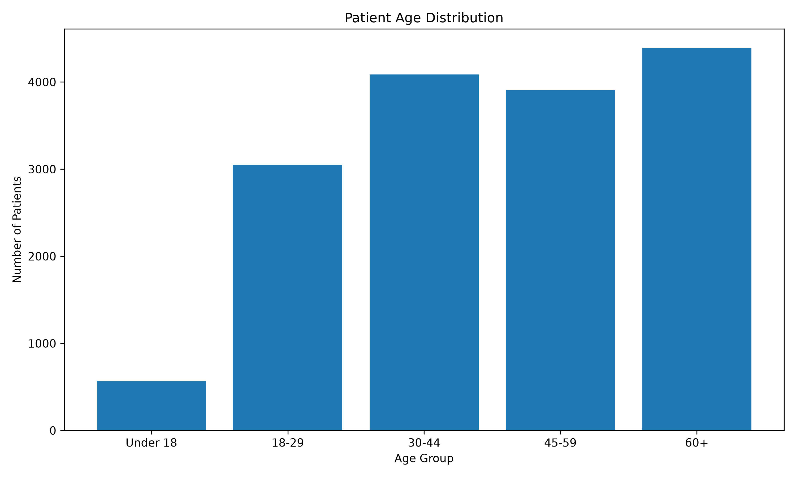
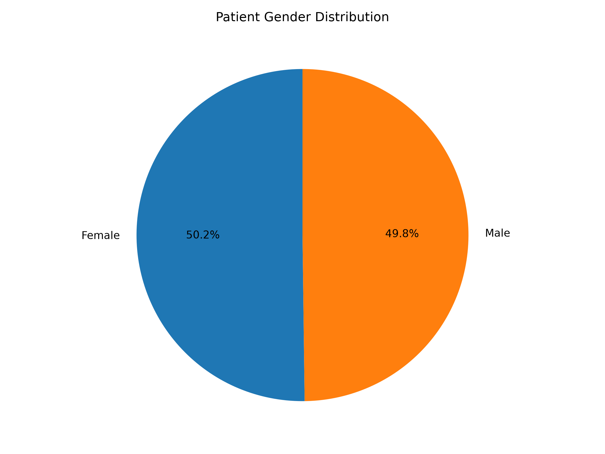
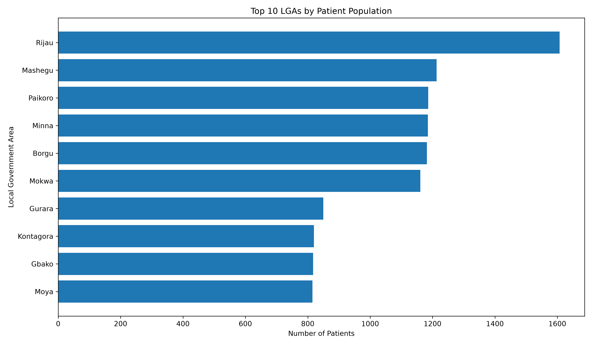
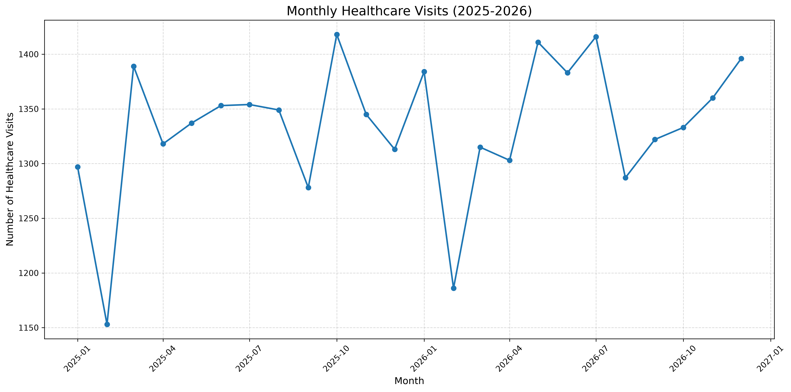
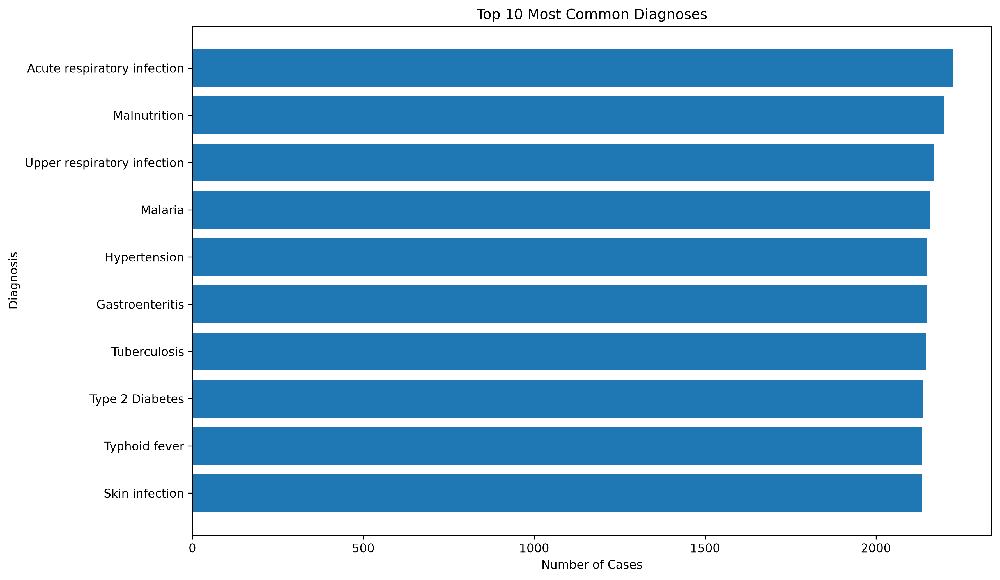

# Community Health Data Pipeline

An end-to-end data engineering and analytics project that demonstrates how community healthcare data can be generated, cleaned, validated, stored, queried, and visualised using Python, PostgreSQL, and SQL.

## Project Overview

Healthcare organisations generate large amounts of data through patient registration, facility visits, diagnoses, and treatment records. Without a structured data management process, it can be difficult to maintain data quality and extract meaningful insights.

This project implements a relational data pipeline for community healthcare data. It covers the movement of data from raw datasets through transformation and validation to PostgreSQL storage and analytical reporting.

The project uses simulated healthcare data and is intended for educational and portfolio demonstration purposes. It does not contain real patient records.

## Project Objectives

* Build an end-to-end data pipeline using Python.
* Clean and transform raw healthcare datasets.
* Validate data quality and relational integrity.
* Design and implement a relational PostgreSQL database.
* Use SQL to analyse healthcare service utilisation.
* Generate visual reports to communicate findings.

## Dataset Overview

The project contains five interconnected datasets:

| Dataset    | Description                                  |
| ---------- | -------------------------------------------- |
| Facilities | Healthcare facility information              |
| Patients   | Patient demographic and registration records |
| Visits     | Healthcare visits and reported symptoms      |
| Diagnoses  | Diagnoses recorded during visits             |
| Treatments | Treatments associated with healthcare visits |

The processed dataset includes:

* 16,000 patient records
* 32,000 healthcare visits

## Technology Stack

| Technology    | Application                               |
| ------------- | ----------------------------------------- |
| Python        | Pipeline development and data processing  |
| Pandas        | Data cleaning and transformation          |
| PostgreSQL    | Relational database management            |
| SQL           | Database queries and analytical reporting |
| Matplotlib    | Data visualisation                        |
| SQLAlchemy    | Database connectivity                     |
| Psycopg2      | PostgreSQL connectivity                   |
| Python-dotenv | Environment variable management           |

## Pipeline Architecture

The project follows these major stages:

1. **Data generation and extraction:** Generate and organise healthcare datasets.
2. **Data inspection:** Examine dataset structure and identify potential quality issues.
3. **Data transformation:** Clean and prepare datasets for analysis and storage.
4. **Data validation:** Check data quality and relational consistency.
5. **Database loading:** Store structured datasets in PostgreSQL.
6. **SQL analysis:** Query the database to extract healthcare insights.
7. **Visualisation:** Generate charts showing demographic patterns and healthcare trends.

## Database Design

The PostgreSQL database consists of five relational tables:

* `facilities`
* `patients`
* `visits`
* `diagnoses`
* `treatments`

Primary keys uniquely identify records, while foreign keys establish relationships between the tables.

The database supports analysis across facilities, patient demographics, healthcare visits, diagnoses, and treatments.

See the documentation:

* [Database Schema](docs/database_schema.md)
* [Pipeline Workflow](docs/pipeline_workflow.md)

## Analytical Outputs

The project generates five visualisations.

### Demographic Analysis

**Age Distribution**



**Gender Distribution**



**Patient Distribution by LGA**



### Healthcare Trends

**Monthly Healthcare Visits**



**Top 10 Diagnoses**



## Project Structure

```text
community-health-data-pipeline/
│
├── data/
│   ├── raw/
│   └── processed/
│
├── docs/
│   ├── database_schema.md
│   └── pipeline_workflow.md
│
├── logs/
│
├── reports/
│   ├── demographics/
│   └── healthcare_trends/
│
├── sql/
│   ├── schema.sql
│   └── analysis.sql
│
├── src/
│   ├── generate_data.py
│   ├── extract.py
│   ├── inspect_data.py
│   ├── transform.py
│   ├── transform_data.py
│   ├── validate_data.py
│   ├── validate_relationships.py
│   ├── create_tables.py
│   ├── load.py
│   ├── load_data.py
│   ├── analytics.py
│   ├── advanced_analysis.py
│   ├── query_results.py
│   ├── verify_database.py
│   ├── visualize_data.py
│   ├── visualize_demographics.py
│   └── visualize_diagnoses.py
│
└── README.md
```

## Data Integrity and Validation

Data validation is an important part of the pipeline.

The relationship validation process checks:

* Duplicate primary key values.
* Invalid foreign key references.
* Consistency between related database tables.

The database relationship validation script completed with zero duplicate identifiers and zero invalid foreign key references across the five tables.

## Getting Started

### Prerequisites

* Python 3.10 or later
* PostgreSQL
* Git
* Visual Studio Code (recommended)

### Installation

Clone the repository:

```bash
git clone <your-repository-url>
cd community-health-data-pipeline
```

Create and activate a virtual environment:

**Windows PowerShell**

```powershell
python -m venv .venv
.venv\Scripts\Activate.ps1
```

Install project dependencies:

```bash
pip install -r requirements.txt
```

### Database Configuration

Create a PostgreSQL database and configure the connection details in a `.env` file in the project root.

Required environment variables:

```env
DB_HOST=localhost
DB_NAME=your_database_name
DB_USER=your_username
DB_PASSWORD=your_password
DB_PORT=5432
```

Do not commit your `.env` file or database credentials to version control.

### Running the Pipeline

The pipeline scripts are located in the `src/` directory.

The main workflow involves:

1. Generating and extracting the datasets.
2. Inspecting and transforming the raw data.
3. Validating the processed datasets.
4. Creating the PostgreSQL tables.
5. Loading the datasets into the database.
6. Running SQL analyses.
7. Generating visualisations.

Refer to the pipeline workflow documentation for details.

## Future Improvements

Potential extensions include:

* Interactive dashboards using Power BI or Tableau.
* Automated pipeline scheduling.
* Advanced healthcare trend analysis.
* Predictive modelling for disease patterns.
* API integration for healthcare data collection.
* Automated data quality monitoring.

## Disclaimer

This project uses simulated healthcare data for learning, demonstration, and portfolio purposes. It is not intended for clinical decision-making or direct use in healthcare operations.

## Author

**Haruna Kudu**

Data Analyst | Agritech & Public Health | Data Systems, Automation & Analytics
