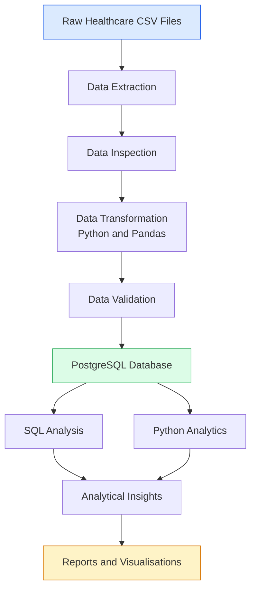

# Community Health Data Pipeline

An end-to-end data engineering and analytics project that demonstrates how community healthcare data can be generated, extracted, cleaned, validated, stored, queried, and visualised using Python, PostgreSQL, and SQL.

## Project Overview

Healthcare organisations generate large volumes of data through patient registration, facility visits, diagnoses, and treatment records. Without effective data management processes, maintaining data quality and extracting meaningful insights can become challenging.

This project implements a relational data pipeline for community healthcare data. It demonstrates the movement of data from raw CSV files through Python-based processing and validation into a PostgreSQL database, where SQL queries and analytical scripts are used to generate insights.

The project uses simulated healthcare data and is intended for educational and portfolio demonstration purposes. It does not contain real patient records.

## Project Objectives

* Develop an end-to-end data pipeline using Python.
* Generate, extract, clean, and transform healthcare datasets.
* Implement data quality and relational integrity checks.
* Design and implement a relational PostgreSQL database.
* Use SQL to analyse healthcare service utilisation.
* Generate visualisations to communicate demographic patterns and healthcare trends.
* Document the pipeline architecture and database structure.

## Dataset Overview

The project contains five interconnected datasets:

| Dataset    | Description                                  |
| ---------- | -------------------------------------------- |
| Facilities | Healthcare facility information              |
| Patients   | Patient demographic and registration records |
| Visits     | Healthcare visits and reported symptoms      |
| Diagnoses  | Diagnoses recorded during healthcare visits  |
| Treatments | Treatments associated with healthcare visits |

### Dataset Summary

The processed datasets contain:

| Metric                     |     Records |
| -------------------------- | ----------: |
| Healthcare facilities      |          40 |
| Patients                   |      16,000 |
| Healthcare visits          |      32,000 |
| Diagnoses                  |      32,000 |
| Treatments                 |      32,000 |
| **Total database records** | **112,040** |

## Technology Stack

| Technology     | Application                                 |
| -------------- | ------------------------------------------- |
| Python         | Data pipeline development and processing    |
| Pandas         | Data cleaning, transformation, and analysis |
| PostgreSQL     | Relational database management              |
| SQL            | Database design, querying, and analysis     |
| Matplotlib     | Data visualisation                          |
| SQLAlchemy     | Database connectivity                       |
| Psycopg2       | PostgreSQL database connectivity            |
| Python-dotenv  | Environment variable management             |
| Git and GitHub | Version control and project hosting         |

## Pipeline Architecture

The pipeline follows seven major stages:

1. **Data Generation and Extraction:** Generate and organise the simulated healthcare datasets.
2. **Data Inspection:** Examine dataset structures and identify potential data quality issues.
3. **Data Transformation:** Clean and prepare datasets using Python and Pandas.
4. **Data Validation:** Check data quality, duplicate identifiers, and relational consistency.
5. **Database Loading:** Store structured datasets in PostgreSQL.
6. **SQL Analysis:** Query the database to extract healthcare insights.
7. **Visualisation:** Generate charts showing demographic distributions and healthcare trends.

### Pipeline Workflow Diagram



## Database Design

The PostgreSQL database consists of five relational tables:

* `facilities`
* `patients`
* `visits`
* `diagnoses`
* `treatments`

Primary keys uniquely identify records, while foreign keys establish relationships between the tables.

The database supports analysis across healthcare facilities, patient demographics, healthcare visits, diagnoses, and treatments.

Additional technical documentation:

* [Database Schema](docs/database_schema.md)
* [Pipeline Workflow](docs/pipeline_workflow.md)

## Data Integrity and Validation

Data quality is an important component of the pipeline.

The validation process checks:

* Duplicate primary key values.
* Invalid foreign key references.
* Consistency between related database tables.
* Data quality issues in the processed datasets.

The relationship validation process completed with zero duplicate identifiers and zero invalid foreign key references across the five database tables.

Database verification also confirmed the expected record counts across all five tables.

## Analytical Outputs and Visualisations

The project generates five visualisations to communicate demographic patterns and healthcare trends.

### 1. Patient Age Distribution


### 2. Patient Gender Distribution


### 3. Patient Distribution by LGA


### 4. Monthly Healthcare Visits


### 5. Top 10 Diagnoses


## Project Structure

```text
community-health-data-pipeline/
│
├── data/
│   ├── raw/
│   └── processed/
│
├── docs/
│   ├── database_schema.md
│   └── pipeline_workflow.md
│
├── reports/
│   ├── demographics/
│   └── healthcare_trends/
│
├── sql/
│   ├── schema.sql
│   └── analysis.sql
│
├── src/
│   ├── generate_data.py
│   ├── extract.py
│   ├── inspect_data.py
│   ├── transform.py
│   ├── transform_data.py
│   ├── validate_data.py
│   ├── validate_relationships.py
│   ├── create_tables.py
│   ├── load.py
│   ├── load_data.py
│   ├── analytics.py
│   ├── advanced_analysis.py
│   ├── query_results.py
│   ├── verify_database.py
│   ├── visualize_data.py
│   ├── visualize_demographics.py
│   └── visualize_diagnoses.py
│
├── .gitignore
├── README.md
└── requirements.txt
```

## Getting Started

### Prerequisites

* Python 3.10 or later
* PostgreSQL
* Git
* Visual Studio Code (recommended)

### 1. Clone the Repository

```bash
git clone https://github.com/sir-haroon/community-health-data-pipeline.git
cd community-health-data-pipeline
```

### 2. Create a Virtual Environment

**Windows PowerShell:**

```powershell
python -m venv .venv
.venv\Scripts\Activate.ps1
```

### 3. Install Dependencies

```bash
pip install -r requirements.txt
```

### 4. Configure the Database

Create a PostgreSQL database and configure the connection details in a `.env` file in the project root.

Required environment variables:

```env
DB_HOST=localhost
DB_NAME=your_database_name
DB_USER=your_username
DB_PASSWORD=your_password
DB_PORT=5432
```

Keep your `.env` file and database credentials private. Do not commit them to GitHub.

### 5. Run the Pipeline

The Python scripts are located in the `src/` directory.

The general workflow involves:

1. Generating and extracting the datasets.
2. Inspecting and transforming the raw data.
3. Validating the processed datasets.
4. Creating the PostgreSQL tables.
5. Loading the datasets into the database.
6. Running SQL analyses.
7. Generating visualisations.

Refer to the documentation in the `docs/` directory for additional information about the pipeline workflow and database schema.

## Future Improvements

Potential extensions to the project include:

* Interactive dashboards using Power BI or Tableau.
* Automated pipeline scheduling.
* Advanced healthcare trend analysis.
* Predictive modelling for disease patterns.
* API integration for healthcare data collection.
* Automated data quality monitoring.
* Cloud database deployment.

## Disclaimer

This project uses simulated healthcare data for learning, demonstration, and portfolio purposes. It is not intended for clinical decision-making or direct use in healthcare operations.

## Author

**Haruna Kudu**

Data Analyst | Agritech & Public Health | Data Systems, Automation & Analytics

GitHub: [sir-haroon](https://github.com/sir-haroon)