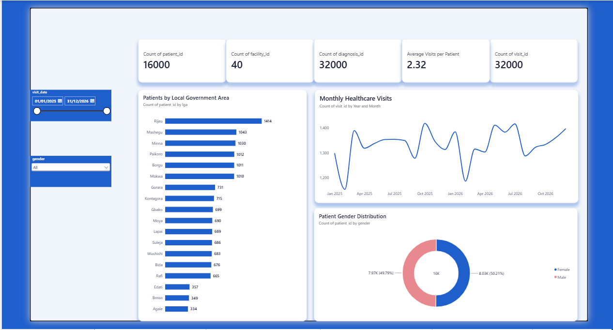
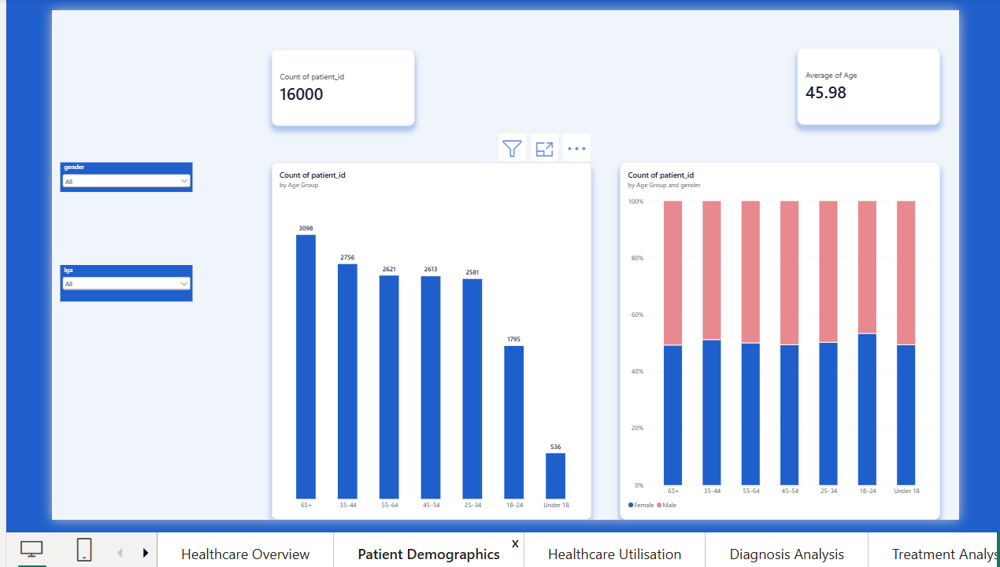
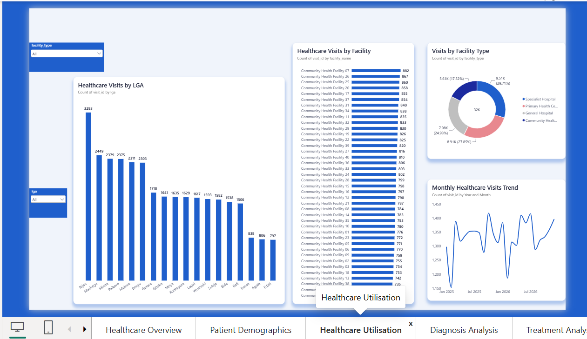
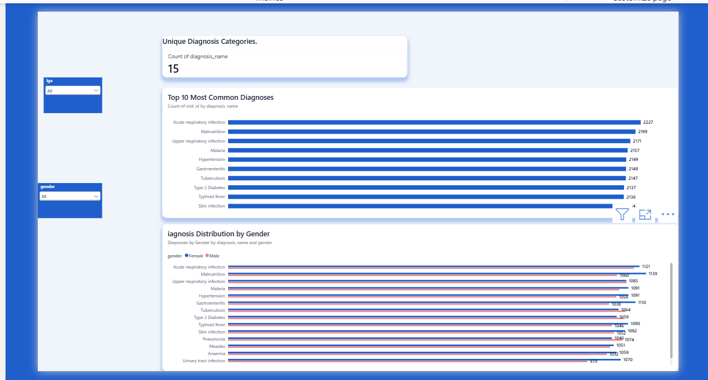
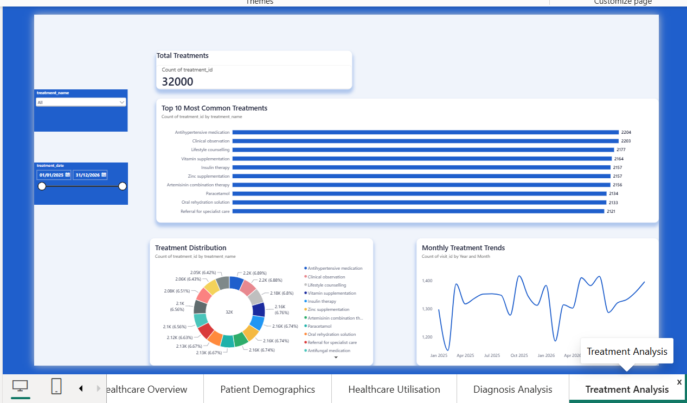

# Community Health Analytics Dashboard

## Overview

An interactive Power BI dashboard built to analyse healthcare service delivery, patient demographics, healthcare utilisation, diagnoses, and treatments across healthcare facilities.

This dashboard is part of the Community Health Data Pipeline project. It transforms structured healthcare data into meaningful visual insights to support data-driven decision-making and healthcare monitoring.

**Note:** The dataset contains synthetic records created for demonstration and portfolio purposes. It does not contain real patient information.

## Dashboard Pages

The dashboard contains five interactive report pages:

### 1. Healthcare Overview

Provides a high-level summary of healthcare activity, including:

* Total registered patients
* Total healthcare visits
* Total healthcare facilities
* Total diagnoses
* Average visits per patient
* Monthly healthcare visits
* Patient distribution by LGA and gender

### 2. Patient Demographics

Explores patient characteristics through:

* Patient population
* Average patient age
* Age group distribution
* Gender distribution across age groups
* Gender and LGA filters

### 3. Healthcare Utilisation

Examines healthcare service utilisation through:

* Visits by healthcare facility
* Visits by LGA
* Monthly healthcare visit trends
* Visits by facility type
* Interactive LGA and facility type filters

### 4. Diagnosis Analysis

Explores patterns in recorded diagnoses through:

* Top 10 most common diagnoses
* Diagnosis distribution by gender
* Number of unique diagnosis categories
* Interactive LGA and gender filters

### 5. Treatment Analysis

Examines treatment records through:

* Total treatments recorded
* Top 10 most common treatments
* Monthly treatment trends
* Treatment distribution
* Interactive treatment name and date filters

## Key Dataset Metrics

| Metric                      | Records |
| --------------------------- | ------: |
| Patients                    |  16,000 |
| Healthcare visits           |  32,000 |
| Healthcare facilities       |      40 |
| Diagnoses                   |  32,000 |
| Treatments                  |  32,000 |
| Unique diagnosis categories |      15 |

## Tools and Technologies

* Microsoft Power BI Desktop
* PostgreSQL
* SQL
* DAX (Data Analysis Expressions)
* Python
* Pandas
* Git and GitHub

## Data Model

The dashboard uses five relational tables:

* `patients`
* `facilities`
* `visits`
* `diagnoses`
* `treatments`

The tables are connected using patient, facility, and visit identifiers to support analysis across the different report pages.

## Interactive Features

* Date range filtering
* Gender filtering
* LGA filtering
* Facility type filtering
* Treatment name filtering
* Top 10 category analysis
* Cross-visual filtering

## Project Files

The Power BI dashboard file is available in this folder:

`Community_Health_Dashboard.pbix`

The PNG screenshots provide static previews of each report page. Download the PBIX file to explore the interactive dashboard in Power BI Desktop.

## Related Project

See the main repository for the data pipeline, data transformation scripts, analysis and project documentation.
